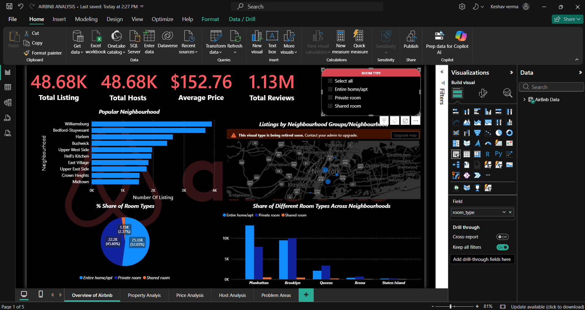
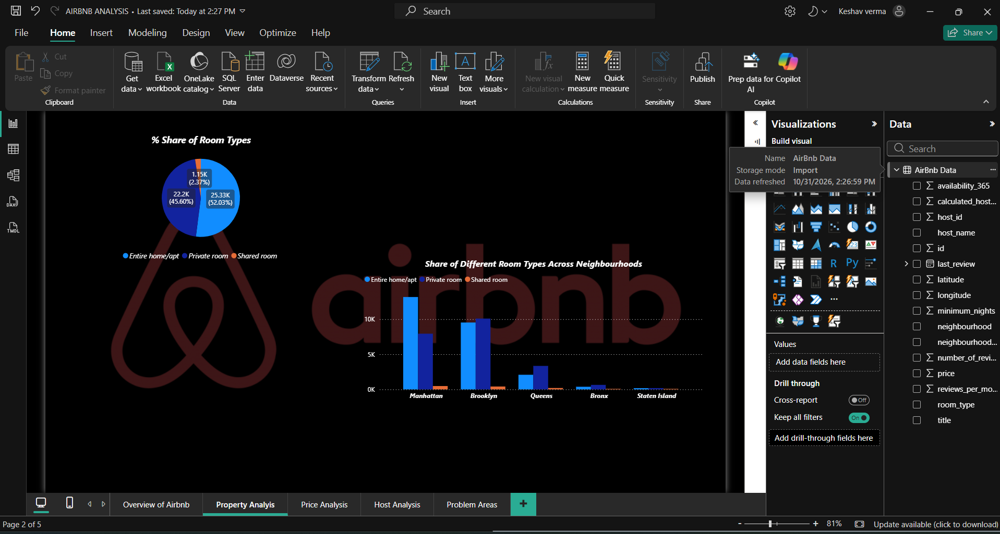
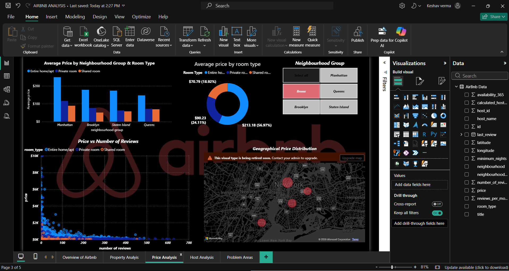
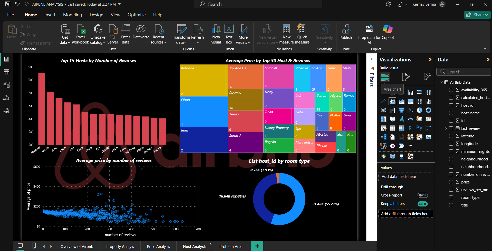
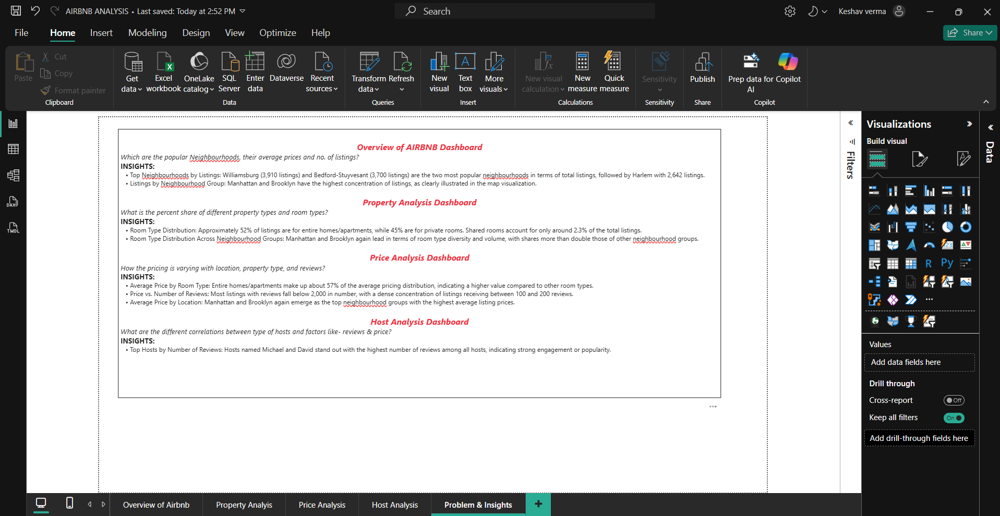

# 🏠 Airbnb Data Analysis Dashboard | Power BI

An interactive Power BI dashboard designed to analyze Airbnb listings, pricing trends, neighbourhood performance, property distribution, and host activity.

## 📌 Project Overview

This project focuses on analyzing Airbnb listing data to uncover meaningful business insights using Microsoft Power BI.

The dashboard transforms raw Airbnb data into interactive visualizations that help understand market trends, compare neighbourhoods, explore pricing patterns, and evaluate host performance.

## 🎯 Project Objectives

- Identify the most popular neighbourhoods based on listing counts.
- Analyze average Airbnb listing prices across locations.
- Understand the distribution of property types and room types.
- Explore the relationship between listing prices and guest reviews.
- Analyze host activity and review performance.
- Present actionable insights through interactive dashboards.

## 🛠️ Tools & Technologies

| Tool | Purpose |
|---|---|
| Microsoft Power BI | Dashboard development and visualization |
| Power Query | Data cleaning and transformation |
| CSV | Dataset storage and data source |
| Data Analytics | Exploratory analysis and business insights |

## 📊 Dashboard Preview

### 1. Overview of Airbnb Dashboard

Analyzes popular neighbourhoods, listing counts, and average prices.



### 2. Property Analysis Dashboard

Explores room type distribution and listing distribution across neighbourhood groups.



### 3. Price Analysis Dashboard

Analyzes average listing prices by room type and location, along with review patterns.



### 4. Host Analysis Dashboard

Explores host performance and identifies hosts with high review counts.



### 5. Problems & Insights

Summarizes key business questions and important findings from the analysis.



## 🔍 Key Business Insights

- Williamsburg and Bedford-Stuyvesant are among the neighbourhoods with the highest listing counts.
- Manhattan and Brooklyn have a high concentration of Airbnb listings.
- Entire homes/apartments account for approximately 52% of listings.
- Private rooms represent approximately 45% of listings.
- Shared rooms account for approximately 2.3% of total listings.
- Entire homes/apartments contribute approximately 57% of the average pricing distribution.
- Most listings have fewer than 2,000 reviews.
- Manhattan and Brooklyn emerge as neighbourhood groups with relatively higher average listing prices.
- Hosts named Michael and David stand out in the analysis of review counts.

## 📁 Repository Structure

```text
Airbnb-Dashboard/
│
├── AIRBNB ANALYSIS.pbix
├── AirBnb_Cleaned.csv
├── Overview.png
├── Property_Analysis.png
├── Price_Analysis.png
├── Host_Analysis.png
├── Prb_Insights.png
└── README.md
```

## 🚀 How to Run the Project

1. Clone or download this repository.
2. Install Microsoft Power BI Desktop.
3. Open `AIRBNB ANALYSIS.pbix`.
4. If prompted, update the data source path to `AirBnb_Cleaned.csv`.
5. Refresh the dataset if required.
6. Explore all five dashboard pages.

## 💡 Skills Demonstrated

- Data Cleaning and Transformation
- Exploratory Data Analysis (EDA)
- Data Visualization
- Business Intelligence
- Power BI Dashboard Development
- Analytical Thinking
- Business Insights Generation

## 📌 Project Outcome

This project demonstrates the use of Power BI to transform Airbnb listing data into meaningful visual insights. It highlights how data analytics can support market understanding, pricing analysis, neighbourhood comparisons, and host performance evaluation.

---

**Developed as a Data Analytics Portfolio Project.**

